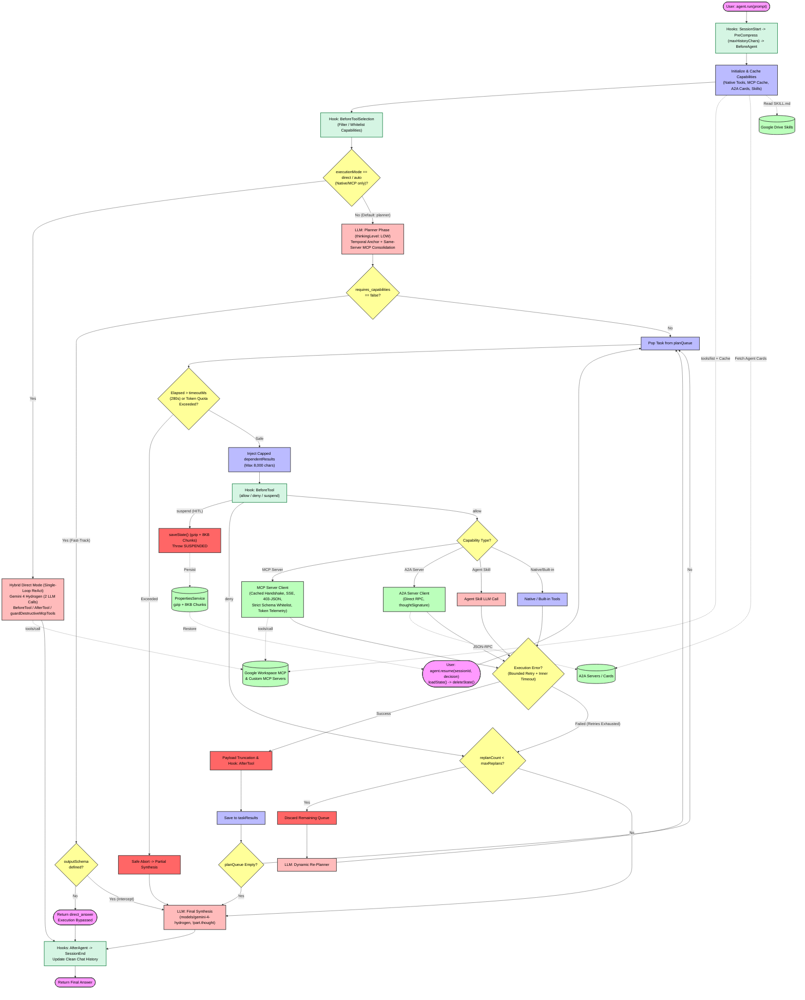

# GASADK (Agent Development Kit for Google Apps Script)


Welcome to **GASADK**, the ultimate Agent Development Kit (ADK) designed specifically for the Google Apps Script (GAS) environment.

Operating within the strict constraints of Google Apps Script—specifically the absolute 6-minute execution limit and synchronous blocking networking—demands an architecture that discards the optimistic assumptions of traditional Node.js environments. **GASADK is a highly engineered survival architecture.** Inspired by the `@google/adk`, this initial release of GASADK introduces the heavily optimized **LlmAgent**. It replaces unbounded, recursive ReAct loops with a deterministic, phase-separated orchestration model, fundamentally solving context bloat, execution latency, and API quota exhaustion.

> [!TIP]
> 🚀 **Looking to turn your Google Workspace APIs into a Model Context Protocol (MCP) server?**  
> Check out our new sample project: [Google API MCP Server Guide](https://github.com/tanaikech/adk-gas/tree/master/samples/googleapiapp-mcp-server) to instantly expose all Google Workspace APIs (Sheets, Drive, Docs, Calendar, Gmail, etc.) as dynamic MCP tools.

---

## 🌟 Architecture & Key Innovations

At the core of GASADK is the **LlmAgent**, powered by the **Planner-Executor-Synthesizer (PES)** architecture. It utilizes Directed Acyclic Graphs (DAGs) to orchestrate complex task delegations across external tools, Model Context Protocol (MCP) servers, Agent-to-Agent (A2A) networks, and file-based Agent Skills.

### Core Safeguards & Optimizations

1. **One-Pass Fast-Track (Zero-Latency Bypass)**
   If the LLM Planner determines that external capabilities are unnecessary for a given prompt (e.g., standard conversational queries), the execution and synthesis phases are completely bypassed. The agent returns a direct response, aggressively slashing API latency and token consumption by avoiding redundant tool queueing.
2. **Schema Interception**
   Even when the Fast-Track attempts to bypass execution, if developers enforce an `outputSchema` (strict JSON formatting), GASADK intelligently intercepts the bypass. It routes the output through a dummy task directly into the Synthesizer to mathematically guarantee adherence to the requested JSON schema under all circumstances.
3. **Temporal Context Anchoring**
   LLMs suffer from temporal blindness—they cannot natively resolve relative time like "tomorrow" or "last week". GASADK intercepts the system prompt and injects a hardcoded `new Date()` absolute anchor. The Planner autonomously converts relative requests into absolute ISO 8601 timestamps before pinging external tools (MCP/A2A), completely eliminating date-resolution errors on remote servers.
4. **Payload Bulletproofing (Pessimistic Memory Management)**
   When external servers or massive Google Drive files return tens of thousands of characters, feeding them directly into the context window triggers a fatal `400 Payload Too Large` error. GASADK enforces a strict `maxResultLength` threshold (default 20,000 chars), automatically truncating overflow data. It favors partial data over catastrophic runtime crashes.
5. **Dynamic Re-Planning (Targeted ReAct)**
   Unlike standard ADKs that rely on a continuous ReAct loop for every step, GASADK plans an entire DAG upfront. Only if a node in the DAG execution fails does the system trigger a Re-Plan. It discards the unexecuted queue, analyzes the failure report, and generates an alternative DAG utilizing different tools.
6. **Clean History Optimization (A2AApp v2.6.0)**
   Maintains and propagates conversation history dynamically to sub-agents, MCP servers, and remote A2A servers without polluting the core logic history. Massive internal intermediate LLM reasoning steps (function calls, planning thoughts) are filtered out, constructing a clean user/model role-based chat history to prevent token bloat and quota exhaustion.
7. **Fast-Track Halt Optimization**
   Allows server functions to forcefully bypass the server-side LLM synthesis loop (by returning `_gemini_halt: true`). This prevents endless generative loops, eliminates unnecessary token usage, and guarantees instant response times for purely algorithmic/computational tool executions.
8. **Direct JSON-RPC Bypass & Direct Routing (v1.3.1)**
   Bypasses the entire multi-phase LLM mock orchestration when `directRouting` is flagged and a single target card is assigned, dispatching the JSON-RPC request natively to slash network latency. It also supports local pre-fetched Agent Cards through `a2aServerAgentCardJSONs` to completely bypass remote HTTP fetches.
9. **Multi-Channel Log Propagation (v1.3.3)**
   Supports explicit log propagation from the orchestrator down to sub-clients (`MCPApp` and `A2AApp`), storing logs inside dedicated, isolated Sheets (`raw`, `MCP`, `A2A`, `MCPA2Aserver_log`) dynamically. It guarantees thread-safe writes using script lock protection under high-concurrency environments.
10. **Global Scope Initialization Fix (v1.3.4)**
    Resolves compilation ReferenceError during global script initialization in Google Apps Script by removing unbound variables (`accessKey`, `webAppsUrl`) from the global context of `agentCard_ToolsForMCPServer.js` and instead using runtime shadow cloning for context safety.

### GASADK vs. TS ADK (`@google/adk`) Paradigm Shift

| Feature              | TypeScript ADK (`@google/adk`)               | GASADK                                                  |
| :------------------- | :------------------------------------------- | :------------------------------------------------------ |
| **Execution Model**  | Recursive ReAct Loop (Step-by-Step).         | Phase-separated DAG execution.                          |
| **I/O Networking**   | Asynchronous I/O, local `stdio`, WebSockets. | Synchronous, thread-blocking HTTP (`UrlFetchApp`).      |
| **Concurrency**      | Highly parallelized (`Promise.all`).         | Strictly sequential execution to prevent quota burnout. |
| **Failure Handling** | Optimistic: Infinite loops possible.         | Pessimistic: Hard aborts at 280s to prevent 6-min kill. |
| **State Protection** | In-memory session tracking.                  | Infrastructure-level locking via `LockService`.         |

---

## ⚙️ GASADK Workflow Architecture (v2.1.1)

The execution lifecycle of `LlmAgent` is rigorously compartmentalized to survive Google Apps Script's 6-minute limit and 9KB `PropertiesService` cap. The diagram below reflects **GASADK v2.1.1**, including **Gemini Decisions API (`gemini-decision-1`) Dynamic Model & Thinking Routing** across all LLM phases (Planner, Direct Mode, Task/SubAgent/MCP/A2A, Synthesis), the Hooks lifecycle, **Hybrid Direct Mode**, **Official Google Workspace MCP** integration with handshake caching, **HITL `suspend`/`resume`** with compressed chunked state persistence, and cumulative token quota safeguards.



---

## 🧩 Supported Capabilities

GASADK acts as a universal adapter, normalizing disparate protocols into a unified schema for the Planner.

- **Native Tools**: Wrap standard Google Apps Script functions directly into the capability schema.
- **MCP Servers**: Native integration to dynamically discover (`tools/list`) and invoke tools on external servers using the Model Context Protocol — including official **Google Workspace MCP Servers** (`drivemcp.googleapis.com`, `gmailmcp.googleapis.com`, etc.) with Streamable HTTP, SSE, and `ToolAnnotations` safety guards.
- **A2A Servers**: Cross-agent communication. Fetch remote Agent Cards and utilize other autonomous agents as local tools via the Agent-to-Agent protocol.
- **Sub-Agents**: Nest instances of `LlmAgent` locally. Delegate complex cognitive sub-tasks without corrupting the main orchestrator's context.
- **Agent Skills**: Dynamically load behavioral skills stored as Markdown (`.md`) files inside Google Drive. A native GAS hack for distributed, RAG-like prompt injection.
- **Built-in Tools**: Comes equipped with Python `CodeExecutor`, native `GoogleSearch`, `UrlContext`, and `FileSearch` RAG capabilities.

---

## 📥 Installation & Core Dependencies

GASADK integrates multiple high-performance GAS libraries under the hood. You can use it as a standalone library or copy the source code directly.

GASADK is constructed by the following scripts.

- [GASADK](https://github.com/tanaikech/adk-gas)
- [GeminiWithFiles](https://github.com/tanaikech/GeminiWithFiles)
- [A2AApp](https://github.com/tanaikech/A2AApp)
- [MCPApp](https://github.com/tanaikech/MCPApp)
- [MCPA2Aserver](https://github.com/tanaikech/MCPA2Aserver-GAS-Library)
- [FileSearchApp](https://github.com/tanaikech/FileSearchApp)

### Option 1: Use as a GAS Library (Recommended)

1. Open your GAS project.
2. Navigate to **Libraries** on the left panel and click **"+"**.
3. Enter the Project Key: `1w2mwhWQd4_6rom-UBRPD8gayBoqGH_87awSBVqGI8DdaQI_pOeSuGYDu`
4. Select the latest version and set the identifier to `GASADK`.
5. Click **Add**.

After GASADK was installed, you can use it as follows.

```javascript
const { LlmAgent, MCPA2Aserver, FileSearch } = GASADK;
```

**All objects are the class objects.**

You can also directly use `GeminiWithFiles`, `A2AApp`, `MCPApp`, and `GasHookManager` like `const { LlmAgent, GeminiWithFiles, MCPA2Aserver, FileSearch, A2AApp, MCPApp, GasHookManager } = GASADK;`.

### Option 2: Copy & Paste Directly

If you want to directly use GASADK by including all scripts in a Google Apps Script project, please copy and paste the following script. The following script includes all required scripts for using GASADK.

[https://github.com/tanaikech/adk-gas/blob/master/dist/GASADK.js](https://github.com/tanaikech/adk-gas/blob/master/dist/GASADK.js)

In this case, you can directly use the class objects without destructuring `GASADK`.

---

## 🛠 `LlmAgent` Configuration API

The `new LlmAgent(config)` constructor accepts an extensive configuration object to dictate agent behavior and safety parameters.

| Parameter                | Type          | Required | Description                                                                                                          |
| :----------------------- | :------------ | :------: | :------------------------------------------------------------------------------------------------------------------- |
| `apiKey`                 | String        | **Yes**  | Your Gemini API Key.                                                                                                 |
| `name`                   | String        |    No    | Internal name of the agent. Defaults to `"Agent"`.                                                                   |
| `description`            | String        |    No    | Agent description. Critical for parent orchestrators utilizing Sub-Agents.                                           |
| `model`                  | String        |    No    | The Gemini model. Defaults to `"models/gemini-4-hydrogen"` (v2.1.0+).                                                |
| `instruction`            | String/Object |    No    | Global system instruction. Supports `{var_name}` interpolation.                                                      |
| `state`                  | Object        |    No    | Key-value mapping for dynamic state variables. Replaces `{var_name}`.                                                |
| `tools`                  | Array         |    No    | Array of native GAS functions mapped to the tool schema.                                                             |
| `mcpServers`             | Array         |    No    | Array of external MCP Server URLs or JSON objects (including official Google Workspace MCP servers).                 |
| `a2aServerAgentCardURLs` | Array         |    No    | Array of remote Agent Card URLs or JSON objects (for custom server routing) for A2A collaboration.                   |
| `a2aServerAgentCardJSONs`| Array         |    No    | Array of local pre-fetched Agent Card JSON objects (supports custom name aliases) to bypass HTTP card retrieval.     |
| `subAgents`              | Array         |    No    | Array of child `LlmAgent` instances for hierarchical delegation.                                                     |
| `skillFolderId`          | String        |    No    | Google Drive Folder ID containing `.md` files for Agent Skills.                                                      |
| `codeExecutor`           | Object        |    No    | Configuration object to enable Python execution Built-in capabilities.                                               |
| `googleSearch`           | Object        |    No    | Configuration object to enable the Built-in Google Search tool.                                                      |
| `urlContext`             | Object        |    No    | Configuration object to enable Built-in URL Context retrieval.                                                       |
| `fileSearch`             | Object        |    No    | Configuration object to enable Built-in File Search (managed RAG).                                                   |
| `generateContentConfig`  | Object        |    No    | Custom Gemini `generationConfig` (e.g., `thinkingConfig: { thinkingLevel: "LOW" \| "MEDIUM" \| "HIGH" \| "XHIGH" }`).|
| `hooks`                  | Array         |    No    | Array of lifecycle hook definitions (`gas_function`, `function`, `webhook`, `command`) for `GasHookManager`.         |
| `executionMode`          | String        |    No    | `"planner"` (default), `"direct"` (single-loop ReAct for Native/MCP, ~3.5x faster), or `"auto"` (v2.1.0+).           |
| `guardDestructiveMcpTools` | Boolean     |    No    | When `true`, blocks MCP tools annotated with `destructiveHint: true` or `readOnlyHint: false` in Direct Mode.        |
| `maxHistoryChars`        | Number        |    No    | Sliding-window character cap for `PreCompress` automatic history trimming. Defaults to `0` (disabled).               |
| `useParametersJsonSchema`| Boolean       |    No    | Opt-in to emit `parametersJsonSchema` instead of sanitized OpenAPI `parameters` on `v1beta`. Defaults to `false`.    |
| `maxTokensPerSession`    | Number        |    No    | Strict per-session token budget safeguard (includes `MCPApp` internal calls and thinking tokens).                    |
| `maxReplans`             | Number        |    No    | Maximum dynamic Re-Plan attempts on execution failure. Defaults to `2`.                                              |
| `timeoutMs`              | Number        |    No    | Milliseconds before triggering a forced abort to evade the GAS 6-minute kill switch. Defaults to `280000` (280s).    |
| `maxResultLength`        | Number        |    No    | Maximum allowed string length per execution before truncation. Prevents payload crashes. Defaults to `20000`.        |
| `outputSchema`           | Object        |    No    | Strict JSON Schema declaration. Forces the Synthesizer to format the output, disabling the direct Fast-Track bypass. |
| `logSpreadsheetId`       | String        |    No    | Google Spreadsheet ID to activate multi-channel logging. Automatically propagates down to `MCPApp` and `A2AApp`.     |

### Custom Server Name Routing (v1.3.0+)

From v1.3.0, you can specify custom user-defined server names in `mcpServers` and `a2aServerAgentCardURLs` by using a JSON object instead of a simple string URL. This custom name is injected into the LLM context to ensure accurate routing when the user references specific servers by their aliases.

#### Format:
- **String URL (Standard)**: `"https://example.com/mcp"`
- **JSON Object (Custom Name)**: `{ "custom-server-alias": { "httpUrl": "https://example.com/mcp" } }`

#### Example:
```javascript
const agent = new LlmAgent({
  apiKey: API_KEY,
  mcpServers: [
    "https://basic.mcp.example.com", // Standard string URL
    {
      "server-trigger-test-project1": { // Custom server name
        httpUrl: "https://script.google.com/macros/s/{deploymentID}/exec?accessKey=sample"
      }
    }
  ],
  a2aServerAgentCardURLs: [
    {
      "my-custom-a2a-agent": { // Custom A2A server name
        httpUrl: "https://script.google.com/macros/s/{deploymentID}/exec/.well-known/agent-card.json?accessKey=sample"
      }
    }
  ]
});
```

### Local JSON Bypass & Direct Routing (v1.3.1+)

From v1.3.1, you can pass pre-fetched Agent Card JSON objects directly to `a2aServerAgentCardJSONs`. This completely bypasses the HTTP card retrieval process, resolving the network latency overhead. When combined with `directRouting`, GASADK automatically bypasses the internal multi-step LLM planning proxy layers, executing direct JSON-RPC dispatch to the remote agent.

#### Example:
```javascript
const agent = new LlmAgent({
  apiKey: API_KEY,
  a2aServerAgentCardJSONs: [
    {
      "local-cached-agent": { // Custom server name
        name: "CachedAgent",
        url: "https://script.google.com/macros/s/{deploymentID}/exec",
        description: "Directly loaded JSON agent card.",
        skills: [
          {
            id: "get_exchange_rate",
            name: "Currency Exchange Rates Tool",
            description: "Helps with exchange values",
            inputModes: ["text/plain"],
            outputModes: ["text/plain"]
          }
        ]
      }
    }
  ]
});
```

### Multi-Channel Log Propagation & Auto-Sheet Initialization (v1.3.3+)

From v1.3.3, you can activate thread-safe, multi-channel logging simply by providing a `logSpreadsheetId` in the `LlmAgent` configuration. When configured, this property is automatically propagated down to downstream `MCPApp` and `A2AApp` instances.

The library validates and automatically creates the following isolated sheets inside the designated spreadsheet:
- **`raw`**: Automatically records serialized raw HTTP event payloads (e.g. GET/POST objects) using safe JSON serialization (`serializeEvent_`) to prevent cyclical structure reference crashes.
- **`MCP`**: Records Model Context Protocol client-side and server-side RPC log history.
- **`A2A`**: Records Agent-to-Agent client-side and server-side transaction logging.
- **`MCPA2Aserver_log`**: Records internal dispatcher execution trails.

All sheet creation and row insertions are protected by thread-safe LockService structures, preventing data loss or layout errors during high-concurrency parallel executions.

#### Example:
```javascript
const agent = new LlmAgent({
  apiKey: API_KEY,
  logSpreadsheetId: "YOUR_LOG_SPREADSHEET_ID_HERE", // Set the ID here
  mcpServers: ["https://example.com/mcp-server"],
  a2aServerAgentCardURLs: ["https://example.com/a2a-server/.well-known/agent-card.json"]
});
```

### Core Methods

- `setServices({ lock, properties })`  
  **Mandatory for safe execution.** Binds `LockService.getScriptLock()` and `PropertiesService` to the agent. Prevents catastrophic state corruption and race conditions when multiple webhooks execute concurrently.
- `run(prompt, logCallback)`  
  Executes the orchestrator. Takes the user `prompt` and an optional `logCallback` function to emit real-time telemetry on DAG planning and execution. Returns the final synthesized string, or a strictly formatted JSON object if `outputSchema` was defined.
- `setHistory(history)`  
  Sets the conversation history for the agent, enabling multi-turn context retention across runs. The history must be an array of objects compatible with GeminiWithFiles.
- `getHistory()`  
  Retrieves the current conversation history.
- `getAgentInf()`  
  An introspection tool that returns an array of all internally normalized capabilities (from Native tools, MCP, A2A, and Skills) bound to the agent.
- `getLogs()`  
  Returns the accumulated execution log entries for the current session.
- `saveState()` / `loadState(sessionId)` / `deleteState(sessionId)` / `resume(sessionId, decision, approvedArgs, logCallback)`  
  Human-in-the-Loop (HITL) persistence and resumption methods. In v2.1.0+, states exceeding 8KB UTF-8 are automatically gzip-compressed and chunked across `PropertiesService`, and `deleteState()` removes all chunks cleanly.
- `LlmAgent.createWorkspaceMcpServers(services, options)` *(Static, v2.1.0+)*  
  Builds official Google Workspace MCP Server configurations (`["drive", "gmail", "docs", "sheets", "slides", "calendar", "chat"]`) with `{ mode: "v1" | "v1self", token }`.
- `getModelRoutingConfig()` / `LlmAgent.getModelRoutingPresets(customConfig?)` *(v2.1.1+)*  
  Exports the current model catalog, pool, routing matrix, and a side-by-side comparison of `fixed`, `efficient`, and `quality` modes as pure, secret-free JSON (**0 API calls**).
- `previewModelRouting(prompt, options?)` *(v2.1.1+)*  
  Dry-run preview: calls the Decisions API once for `prompt` and returns a JSON comparison of which model & `thinkingLevel` `fixed`, `efficient`, and `quality` modes would select—without executing `generateContent`.
- `getRoutingHistory()` *(v2.1.1+)*  
  Returns structured routing decision logs (`model`, `thinkingLevel`, `mode`, `reason`, `decisionsLatencyMs`, `decisionsInputTokens`) recorded during execution.
- `LlmAgent.configureModelRouting(customConfig)` / `LlmAgent.registerModels(modelsMap)` / `LlmAgent.resetModelRoutingDefaults()` *(Static, v2.1.1+)*  
  Globally customizes or registers future Gemini models (`supportedThinkingLevels`, `defaultThinkingLevel`, `paidOnly`, `modelPool`, `routingMatrix`) across all GASADK modules.

---

## 🧠 Dynamic Model & Thinking Routing via Gemini Decisions API (v2.1.1+)

GASADK v2.1.1 integrates a zero-dependency, data-driven **`GeminiDecisionsRouter`** powered by the **Gemini Decisions API (`gemini-decision-1`, $0.10 / 1M input tokens, $0.00 / 0 output tokens)** across all Gemini API call sites (`LlmAgent`, `SubAgent`, `MCPApp`, `A2AApp`, `MCPA2Aserver`, `FileSearchApp`, and `GeminiWithFiles`).

### Routing Modes (`modelRouting`)

| Mode | Behavior | Recommended Use |
| :--- | :--- | :--- |
| **`"efficient"`** *(Default)* | Uses `gemini-decision-1` to pick the lowest-cost fast model & `thinkingLevel` (`gemini-3.5-flash-lite` / `gemini-3.8-flash` / `gemini-4-hydrogen`), and **automatically escalates** to frontier models (`gemini-4-argon` / `gemini-4-carbon`) when complex reasoning or an explicit maximum-capability directive (e.g., *"use maximum capability"*, *"最大の能力で実行して"*) is detected. | Everyday production workloads (slashes cost & latency while preserving frontier capability on demand). |
| **`"quality"`** | Uses `gemini-decision-1` to prioritize maximum accuracy and deeper thinking (`gemini-4-hydrogen` / `gemini-4-neon` / `gemini-4-argon` / `gemini-4-carbon`) with GAS 6-minute timeout guardrails. | High-stakes analysis, architecture design, auditing, and synthesis. |
| **`"fixed"`** | Bypasses the Decisions API completely (**0 routing calls**) and uses only your configured `model` and `generateContentConfig`. | Strict model pinning and deterministic benchmarks. |

### Default 6-Model Pool & Built-in Safeguards

| Tier Key | Default Model | Supported `thinkingLevel` | Free Tier |
| :--- | :--- | :--- | :---: |
| `lite` | `models/gemini-3.5-flash-lite` | `MINIMAL`, `LOW`, `MEDIUM`, `HIGH` | Yes |
| `fast` | `models/gemini-3.8-flash` | `LOW`, `MEDIUM`, `HIGH` | Yes |
| `workhorse` | `models/gemini-4-hydrogen` | `LOW`, `MEDIUM`, `HIGH`, `XHIGH` | Yes |
| `premium` | `models/gemini-4-neon` | `LOW`, `MEDIUM`, `HIGH`, `XHIGH` | Paid only |
| `frontierFast` | `models/gemini-4-argon` | `LOW`, `MEDIUM`, `HIGH` *(no `XHIGH`)* | Paid only |
| `frontierMax` | `models/gemini-4-carbon` | `LOW`, `MEDIUM`, `HIGH` *(no `XHIGH`)* | Paid only |

- **Automatic Free-Tier Fallback (`billingTier: "auto"`)**: If a Paid-only model (`neon`/`argon`/`carbon`) returns HTTP 403/429, GASADK automatically falls back to `models/gemini-4-hydrogen (HIGH)` and caches the fallback for the run.
- **GAS 6-Minute Timeout Guard**: Automatically steps down heavy frontier models/thinking levels when remaining `timeoutMs` drops below 90s / 45s, and defaults `allowXHighInGas: false` to prevent synchronous timeouts.
- **Implicit Prefix Caching Protection**: Routing runs once per request before any tool-calling loop—never mid-loop—preserving Gemini 4/3 implicit prefix caching and `thoughtSignature` integrity.
- **Per-Generation Logging**: Every generation step emits `[ModelRouting] role=... | mode=... | model=... | thinking=... | reason=... (decisions=...ms)` to `logCallback`, `agent.logs`, and `agent.getRoutingHistory()`.

### Usage: Modes, JSON Comparison & Future-Model Customization

```javascript
function demoDynamicModelRouting() {
  const { LlmAgent } = GASADK;
  const properties = PropertiesService.getScriptProperties();
  const apiKey = properties.getProperty("GEMINI_API_KEY");

  // 1. Inspect & compare fixed / efficient / quality settings as JSON (0 API calls)
  const agent = new LlmAgent({
    apiKey,
    name: "AdaptiveAgent",
    modelRouting: "efficient", // "efficient" (default) | "quality" | "fixed"
  }).setServices({ lock: LockService.getScriptLock(), properties });

  console.log(JSON.stringify(agent.getModelRoutingConfig(), null, 2));

  // 2. Dry-run preview for a specific prompt without generating content
  const preview = agent.previewModelRouting("Use maximum capability to audit this architecture.");
  console.log(JSON.stringify(preview, null, 2));

  // 3. Register a future Gemini model externally without waiting for a library release
  LlmAgent.configureModelRouting({
    modelCatalog: {
      "models/gemini-5-alpha": {
        tier: "frontierMax",
        supportedThinkingLevels: ["LOW", "MEDIUM", "HIGH", "XHIGH"],
        defaultThinkingLevel: "HIGH",
        supportsThinkingBudget: false,
        paidOnly: true,
      },
    },
    modelPool: { frontierMax: "models/gemini-5-alpha" },
  });

  // 4. Execute with live [ModelRouting] logs showing exact model & thinkingLevel used
  const answer = agent.run("Summarize the 3 key benefits of Apps Script.", (logEntry) => {
    console.log(`[Log ${logEntry.timestamp}] ${logEntry.message}`);
  });
  console.log(answer);
  console.log("Routing History:", JSON.stringify(agent.getRoutingHistory(), null, 2));
}
```

---

## 💻 Quick Start & Usage Examples

When you try to test the following sample script, please set your API key for using Gemini API to the property `GEMINI_API_KEY` of Google Apps Script project.

### 1. Minimal Quickstart (Fast-Track Routing)

A basic conversational initialization.

```javascript
// Remove destructuring if you copied the scripts directly.
const { LlmAgent } = GASADK;

function test_quickstart() {
  const properties = PropertiesService.getScriptProperties();
  const API_KEY = properties.getProperty("GEMINI_API_KEY");

  const agent = new LlmAgent({
    apiKey: API_KEY,
    name: "HelperAgent",
    model: "models/gemini-4-hydrogen",
    instruction: "You are a helpful AI assistant.",
  });

  agent.setServices({
    lock: LockService.getScriptLock(),
    properties: properties,
  });

  // Because no tools are required, the Fast-Track bypass routes this directly.
  const response = agent.run("Hello, who are you?", (logEntry) => {
    console.log(`[Log ${logEntry.timestamp}] ${logEntry.message}`);
  });

  console.log(response);
}
```

In the following script, the second argument receives the detailed real-time log as a callback function.

```javascript
const response = agent.run("Hello, who are you?", (logEntry) => {
  console.log(`[Log ${logEntry.timestamp}] ${logEntry.message}`);
});
```

### 2. Use subagents

Subagents are used.

```javascript
// Remove destructuring if you copied the scripts directly.
const { LlmAgent } = GASADK;

function test_subagents() {
  const properties = PropertiesService.getScriptProperties();
  const API_KEY = properties.getProperty("GEMINI_API_KEY");
  const MODEL_NAME = "models/gemini-4-hydrogen";

  const translator = new LlmAgent({
    apiKey: API_KEY,
    name: "Translator",
    description: "Translates any given text to German.",
    instruction: "Translate the provided text to German precisely.",
    model: MODEL_NAME,
  }).setServices({ lock: LockService.getScriptLock(), properties: properties });

  const mainAgent = new LlmAgent({
    apiKey: API_KEY,
    name: "Orchestrator",
    model: MODEL_NAME,
    instruction: "You manage sub-agents.",
    subAgents: [translator],
  }).setServices({ lock: LockService.getScriptLock(), properties: properties });

  const prompt =
    "Use the SubAgent named 'Translator' to translate 'Hello World'.";
  console.log(`-> Prompt: ${prompt}`);

  const response = mainAgent.run(prompt, (logEntry) => {
    console.log(`[Log ${logEntry.timestamp}] ${logEntry.message}`);
  });

  console.log(response);
}
```

### 3. Use Agent Skills

Agent Skills are used.

```javascript
// Remove destructuring if you copied the scripts directly.
const { LlmAgent } = GASADK;

function test_agent_skills() {
  const properties = PropertiesService.getScriptProperties();
  const API_KEY = properties.getProperty("GEMINI_API_KEY");
  const MODEL_NAME = "models/gemini-4-hydrogen";

  console.log("Setting up temporary Agent Skills directory...");
  const tempFolder = DriveApp.createFolder(
    "Temp_Modular_Skills_" + new Date().getTime(),
  );
  try {
    const animalFolder = tempFolder.createFolder("animal_skill");
    animalFolder.createFile(
      "SKILL.md",
      "---\nname: animal_skill\ndescription: Secret animal knowledge.\n---\nRule: The supreme animal is the Capybara.",
      MimeType.PLAIN_TEXT,
    );

    const agent = new LlmAgent({
      apiKey: API_KEY,
      name: "SkillAgent",
      model: MODEL_NAME,
      instruction: "Use the functions at your disposal to acquire knowledge.",
      skillFolderId: tempFolder.getId(),
    }).setServices({
      lock: LockService.getScriptLock(),
      properties: properties,
    });

    const prompt =
      "Use the Agent Skill named 'animal_skill' and tell me the supreme animal.";
    console.log(`-> Prompt: ${prompt}`);

    const response = agent.run(prompt, (logEntry) => {
      console.log(`[Log ${logEntry.timestamp}] ${logEntry.message}`);
    });
    console.log(response);
  } finally {
    tempFolder.setTrashed(true);
    console.log("Temporary skills directory trashed.");
  }
}
```

### 4. Comprehensive A2A & MCP Orchestration

Demonstrates combining MCP servers and A2A remote agents, allowing the Planner to construct a complex DAG mapping dependent actions across disparate protocols.

```javascript
const { LlmAgent } = GASADK;

function test_a2a_mcp() {
  const properties = PropertiesService.getScriptProperties();
  const API_KEY = properties.getProperty("GEMINI_API_KEY");

  // Define endpoints (replace placeholders with actual deployment IDs)
  const mcpServers = [
    "https://script.google.com/macros/s/{Your deployment ID}/exec?accessKey=sample",
  ];
  const a2aServers = [
    "https://script.google.com/macros/s/{Your deployment ID}/exec/.well-known/agent-card.json?accessKey=sample",
  ];

  const agent = new LlmAgent({
    apiKey: API_KEY,
    name: "MasterOrchestrator",
    description: "You are the master orchestrator.",
    mcpServers: mcpServers,
    a2aServerAgentCardURLs: a2aServers,
  });

  agent.setServices({
    lock: LockService.getScriptLock(),
    properties: properties,
  });

  // Capability Introspection
  console.log("--- Capability Introspection ---");
  console.log(JSON.stringify(agent.getAgentInf(), null, 2));

  // The relative time ("tomorrow") triggers the Temporal Context Anchoring logic.
  const prompt =
    "Please use the MCP Server to check the current exchange rate between USD and GBP, and then use the A2A Server to get the weather in Tokyo for tomorrow's lunchtime.";

  const result = agent.run(prompt, (logEntry) => {
    console.log(`[Log ${logEntry.timestamp}] ${logEntry.message}`);
    if (logEntry.data && logEntry.data.plan) {
      console.log("=== Execution Plan (DAG) ===");
      console.log(JSON.stringify(logEntry.data.plan, null, 2));
    }
  });

  console.log("--- Final Synthesized Result ---");
  console.log(result);
}
```

### 5. Deploying a Consolidated A2A & MCP Server

GASADK includes `MCPA2Aserver`, allowing you to expose your own native GAS functions as **both** an MCP Server and an A2A Server simultaneously from a single web app deployment.

**In this case, after you deploy Web Apps, set `WEB_APPS_URL` by replacing with your Web Apps URL and deploy Web Apps to reflect the latest script.**

```javascript
const { MCPA2Aserver } = GASADK;

const API_KEY =
  PropertiesService.getScriptProperties().getProperty("GEMINI_API_KEY");
const WEB_APPS_URL =
  "https://script.google.com/macros/s/{Your deployment ID}/exec";

const object = {
  apiKey: API_KEY,
  model: "models/gemini-4-hydrogen",
  accessKey: "sample",
};

const doGet = (e) => main(e);
const doPost = (e) => main(e);

function main(e) {
  const lock = LockService.getScriptLock();
  const context = createServerContext_(); // Defines functions and agentCard
  const m = new MCPA2Aserver();

  m.setServices({ lock: lock });
  m.apiKey = object.apiKey;
  m.model = object.model;

  // Pre-configure server-side injected history (System Context/Persona)
  m.setHistory([
    {
      role: "user",
      parts: [{ text: "System Context Override: You are an elite financial API node named OMEGA-SERVER, located securely in Tokyo." }]
    },
    {
      role: "model",
      parts: [{ text: "Understood. My secret access code is OMEGA-99." }]
    }
  ]);

  // Force enablement of both server protocols
  m.a2a = true;
  m.mcp = true;
  m.accessKey = object.accessKey;

  const res = m.main(e, context, (log) => {
    console.log(`[${log.level}] ${log.timestamp} - ${log.message}`);
  });

  return res;
}

function createServerContext_() {
  const functions = {
    params_: {
      get_exchange_rate: {
        description: "Get current exchange rate.",
        parameters: {
          type: "object",
          properties: {
            currency_from: { type: "string" },
            currency_to: { type: "string" },
            currency_date: { type: "string" },
          },
          required: ["currency_from", "currency_to", "currency_date"],
        },
      },
      chat_and_identity: {
        description: "Answer general conversation, identity, location, and secret code questions based on the chat history.",
        parameters: {
          type: "object",
          properties: {
            message: { type: "string", description: "The complete, detailed response message." }
          },
          required: ["message"]
        }
      }
    },
    get_exchange_rate: (args) => {
      // Internal execution logic here...
      const res = `Rate from ${args.currency_from} to ${args.currency_to} is 0.82.`;

      const returnObj = {
        mcp: {
          jsonrpc: "2.0",
          result: { content: [{ type: "text", text: res }], isError: false },
        },
        a2a: { result: res },
      };

      // [Fast-Track Halt Optimization]: Return immediately to bypass secondary LLM synthesis loops
      return {
        ...returnObj,
        _gemini_halt: true,
        items: { functionResponse: returnObj }
      };
    },
    chat_and_identity: (args) => {
      const res = args.message || "I have processed your chat request.";
      const returnObj = {
        mcp: {
          jsonrpc: "2.0",
          result: { content: [{ type: "text", text: res }], isError: false },
        },
        a2a: { result: res },
      };
      return {
        ...returnObj,
        _gemini_halt: true,
        items: { functionResponse: returnObj }
      };
    }
  };

  const agentCard = {
    name: "API Manager",
    description: "Provide management for using various APIs and handle conversational queries.",
    url: WEB_APPS_URL + `?accessKey=${object.accessKey}`,
    skills: [
      { id: "get_exchange_rate", name: "Exchange Rate Tool" },
      { id: "chat_and_identity", name: "Chat and Identity" }
    ],
  };

  return { functions, agentCard };
}
```

### 6. Chat History & Context Retention

GASADK supports seamless multi-turn conversation tracking across the orchestrator, remote agents, and Consolidated servers.

```javascript
const { LlmAgent } = GASADK;

function test_chat_history() {
  const properties = PropertiesService.getScriptProperties();
  const API_KEY = properties.getProperty("GEMINI_API_KEY");

  const agent = new LlmAgent({
    apiKey: API_KEY,
    name: "ChattyAgent",
    model: "models/gemini-4-hydrogen",
  }).setServices({ lock: LockService.getScriptLock(), properties: properties });

  // 1. Manually seed/restore conversation history
  agent.setHistory([
    { role: "user", parts: [{ text: "Hello, my project code is XRAY-7." }] },
    { role: "model", parts: [{ text: "Acknowledged. I have recorded your project code as XRAY-7." }] }
  ]);

  // 2. Run query referencing the context
  const response = agent.run("What is my project code?");
  console.log("Response:", response); // Output will resolve using the history

  // 3. Inspect updated history
  console.log("Updated History:", JSON.stringify(agent.getHistory(), null, 2));
}
```

### 7. Exposing Google APIs as a Dynamic MCP/A2A Server (via GoogleApiApp)

By combining **GASADK** with the **GoogleApiApp** library, you can build a stateless proxy that dynamically exposes Google Workspace services (Sheets, Drive, Docs, Calendar, Gmail, Slides, etc.) to any LLM-powered agent as local MCP tools.

For the full implementation script and a beginner-friendly setup guide, see:
👉 **[Google API MCP Server Sample & Setup Guide](https://github.com/tanaikech/adk-gas/tree/master/samples/googleapiapp-mcp-server)**

### 8. Using Official Google Workspace MCP Servers (GA — November 2026)

Google's official hosted **Google Workspace MCP servers** are now **Generally Available (GA)** ([Official Google Workspace Updates Announcement](https://workspaceupdates.googleblog.com/2026/11/mcp-servers-cli-standardized-usage-tiers-now-available.html)). With **GASADK v2.1.0+**, you can connect Google Apps Script directly to Google's remote Workspace MCP servers using `ScriptApp.getOAuthToken()` without deploying any proxy server.

#### Available Official Google Workspace MCP Endpoints

| Workspace Product | Primary Endpoint (`/mcp/v1`) | Self-Mode Fallback (`/mcp/v1self`) | Required GCP Services |
| :--- | :--- | :--- | :--- |
| **Google Drive** | `https://drivemcp.googleapis.com/mcp/v1` | `https://drivemcp.googleapis.com/mcp/v1self` | `drive.googleapis.com`, `drivemcp.googleapis.com` |
| **Gmail** | `https://gmailmcp.googleapis.com/mcp/v1` | `https://gmailmcp.googleapis.com/mcp/v1self` | `gmail.googleapis.com`, `gmailmcp.googleapis.com` |
| **Google Calendar** | `https://calendarmcp.googleapis.com/mcp/v1` | `https://calendarmcp.googleapis.com/mcp/v1self` | `calendar-json.googleapis.com`, `calendarmcp.googleapis.com` |
| **Google Docs** | `https://docsmcp.googleapis.com/mcp/v1` | `https://docsmcp.googleapis.com/mcp/v1self` | `docs.googleapis.com`, `docsmcp.googleapis.com` |
| **Google Sheets** | `https://sheetsmcp.googleapis.com/mcp/v1` | `https://sheetsmcp.googleapis.com/mcp/v1self` | `sheets.googleapis.com`, `sheetsmcp.googleapis.com` |
| **Google Slides** | `https://slidesmcp.googleapis.com/mcp/v1` | `https://slidesmcp.googleapis.com/mcp/v1self` | `slides.googleapis.com`, `slidesmcp.googleapis.com` |
| **Google Chat** | `https://chatmcp.googleapis.com/mcp/v1` | `https://chatmcp.googleapis.com/mcp/v1self` | `chat.googleapis.com`, `chatmcp.googleapis.com` |
| **Google Tasks** | `https://tasksmcp.googleapis.com/mcp/v1` | `https://tasksmcp.googleapis.com/mcp/v1self` | `tasks.googleapis.com`, `tasksmcp.googleapis.com` |
| **Universal Search** | `https://workspacemcp.googleapis.com/mcp/v1` | — | `workspacemcp.googleapis.com` |

> [!NOTE]
> - **Usage Tiers**: Google Cloud projects receive the **Standard Tier** automatically at **no cost** (no billing account required, up to **5,000 requests/day per project per product** across GA Workspace MCP servers). High-volume production workloads can upgrade to the **Scaled Tier** by linking a Google Cloud Billing account.
> - **`/mcp/v1` vs `/mcp/v1self`**: `/mcp/v1` exposes the full toolset (supporting server-driven HITL form elicitation). For headless or non-interactive clients that do not implement form-mode elicitation UIs, `/mcp/v1self` provides a self-mode fallback toolset.
> - **Workspace Admin Controls**: For Google Workspace organization accounts, administrators can govern OAuth Client IDs, audit logs, DLP policies, and approval workflows under **Admin Console → Security → API Controls**.

#### Step-by-Step Installation & Setup Guide

1. **Create a GAS Project & Add the GASADK Library**
   - Open [script.google.com](https://script.google.com/) and create a new Apps Script project.
   - Click **Libraries (+)**, enter Script ID `1w2mwhWQd4_6rom-UBRPD8gayBoqGH_87awSBVqGI8DdaQI_pOeSuGYDu`, select the latest version (**v2.1.0+**), and set the Identifier to `GASADK`.
   - Under **Project Settings → Script Properties**, add `GEMINI_API_KEY` with your Gemini API key.

2. **Link Your Apps Script Project to a Standard Google Cloud Project**
   - Default Apps Script Cloud projects cannot manually enable `*mcp.googleapis.com` services. You must link a **Standard Google Cloud Project** ([Official Guide](https://developers.google.com/apps-script/guides/cloud-platform-projects)):
     1. In the Apps Script editor, open **Project Settings** (gear icon).
     2. Under **Google Cloud Project**, click **Change project**.
     3. Enter your standard Google Cloud **Project Number** and click **Set project**.
     *(Note: Switching to a standard GCP project is irreversible and requires re-authorizing the script.)*

3. **Enable Both the Workspace API and the MCP Service in Google Cloud**
   - Enable **both** the underlying Workspace API and its companion MCP service on the linked standard Google Cloud project:
     ```bash
     # Example for Google Drive MCP Server
     gcloud services enable --project=YOUR_PROJECT_ID \
       drive.googleapis.com \
       drivemcp.googleapis.com
     ```
   - Or via **Google Cloud Console → APIs & Services → Library**: search for and enable both **Google Drive API** (`drive.googleapis.com`) and **Google Drive MCP API** (`drivemcp.googleapis.com`).

4. **Configure `appsscript.json` Manifest & OAuth Scopes**
   - In Apps Script **Project Settings**, check **"Show 'appsscript.json' manifest file in editor"**, then add `oauthScopes` matching least-privilege access ([Official Scopes Guide](https://developers.google.com/apps-script/concepts/scopes)):
     ```json
     {
       "timeZone": "Asia/Tokyo",
       "dependencies": {
         "libraries": [
           {
             "userSymbol": "GASADK",
             "version": "0",
             "libraryId": "1w2mwhWQd4_6rom-UBRPD8gayBoqGH_87awSBVqGI8DdaQI_pOeSuGYDu",
             "developmentMode": true
           }
         ]
       },
       "exceptionLogging": "STACKDRIVER",
       "runtimeVersion": "V8",
       "oauthScopes": [
         "https://www.googleapis.com/auth/drive.readonly",
         "https://www.googleapis.com/auth/script.external_request"
       ]
     }
     ```
     *(Use `https://www.googleapis.com/auth/drive.readonly` for read-only listing/search, or `https://www.googleapis.com/auth/drive` if your agent also creates or modifies files.)*

5. **Run the Sample Script (`Code.gs`)**

```javascript
/**
 * Connects GASADK (v2.1.0+) directly to the official Google Drive MCP Server
 * using ScriptApp.getOAuthToken() and lists the 5 most recent files.
 */
function listRecentDriveFilesWithWorkspaceMcp() {
  const prompt =
    "List the 5 most recent files from Google Drive. If an error occurs, display the raw error message.";

  const { LlmAgent } = GASADK;
  const properties = PropertiesService.getScriptProperties();
  const apiKey = properties.getProperty("GEMINI_API_KEY");
  if (!apiKey) {
    throw new Error("Please set 'GEMINI_API_KEY' in Script Properties.");
  }

  // Option A: Explicit Google Drive MCP Server configuration
  const mcpServers = [
    {
      drive_mcp: {
        httpUrl: "https://drivemcp.googleapis.com/mcp/v1", // Or "/mcp/v1self" for self-mode fallback
        headers: {
          authorization: "Bearer " + ScriptApp.getOAuthToken(),
        },
      },
    },
  ];
  // Option B (Shorthand in v2.1.0+):
  // const mcpServers = LlmAgent.createWorkspaceMcpServers(["drive"], { mode: "v1" });

  const agent = new LlmAgent({
    apiKey,
    name: "GoogleDriveMcpAssistant",
    // Default model in v2.1.0+ is "models/gemini-4-hydrogen"
    instruction: "You are a helpful Google Workspace AI assistant.",
    // Optional: set executionMode: "direct" for ~3.5x faster single-loop MCP execution
    mcpServers,
  });

  agent.setServices({
    lock: LockService.getScriptLock(),
    properties,
  });

  const response = agent.run(prompt, (logEntry) => {
    const detail = logEntry.data?.error ? ` | Error: ${logEntry.data.error}` : "";
    console.log(`[Log ${logEntry.timestamp}] ${logEntry.message}${detail}`);
  });
  console.log(response);
}
```

---

## 🛡 Hooks System & Workspace Safety Guardrails (v1.3.5+)

GASADK introduces a comprehensive Hooks system fully compliant with the Gemini CLI specifications. Developers can intercept the execution lifecycle of the agent, apply validations, inject context, mock responses, or enforce safety guardrails.

### Lifecycle Hook Events
The system supports the following lifecycle events:
* **SessionStart**: Triggered at session initiation (useful for context load or initialization).
* **SessionEnd**: Triggered at session termination (exit or error).
* **BeforeAgent**: Fired after user input but before planning. Can block execution or inject prompt context.
* **AfterAgent**: Fired after the final synthesis. Can trigger context clearing or execute conditional retries.
* **BeforeModel**: Fired before LLM request transmission. Allows config override or returning mock responses.
* **AfterModel**: Fired upon receiving LLM response. Allows response rewriting or blocking.
* **BeforeToolSelection**: Fired before capability selection. Allows toolMode and function white-listing.
* **BeforeTool**: Fired before a tool is executed. Blocks execution or overrides arguments.
* **AfterTool**: Fired after tool execution. Allows result editing, masking, or error handling.
* **PreCompress**: Fired before history context compaction occurs.
* **Notification**: Fired when system logs or alerts occur.

---

### Workspace Safety Guardrails Example
Below is a practical implementation of **BeforeTool** hooks to construct safety guardrails. It prevents an autonomous agent from executing dangerous operations (e.g., sending emails to external addresses or deleting critical folders) by validating model-generated arguments at the tool execution boundary.

#### 1. Defining the Guardrail Hook
This GAS function intercepts Gmail transmission and Drive folder deletion:

```javascript
function checkWorkspaceSafetyGuardrail(input) {
  const toolInput = input.tool_input || {};
  
  // Gmail Safety Check: Block external domains
  if (input.tool_name === "gmail_send_email") {
    const toAddress = toolInput.to || "";
    if (!toAddress || !toAddress.endsWith("@mycompany.com")) {
      return {
        decision: "deny",
        reason: "Blocked: Sending mail to external domains (" + toAddress + ") is restricted."
      };
    }
  }
  
  // Google Drive Safety Check: Prevent critical asset deletion
  if (input.tool_name === "drive_delete_file") {
    const fileId = toolInput.fileId || "";
    if (fileId === "protected_root_id") {
      return {
        decision: "deny",
        reason: "Blocked: Deletion of the protected root resource is strictly prohibited."
      };
    }
  }
  
  return { decision: "allow" };
}
```

#### 2. Registering Hooks in the Agent Config
Instantiate the `LlmAgent` with the safety hook registered under the `BeforeTool` event:

```javascript
const agent = new LlmAgent({
  apiKey: API_KEY,
  name: "SecureWorkspaceAgent",
  hooks: {
    "BeforeTool": [
      {
        "matcher": "gmail_send_email|drive_delete_file", // RegExp tool matching
        "type": "gas_function",
        "functionName": "checkWorkspaceSafetyGuardrail"
      }
    ]
  },
  tools: [
    {
      name: "gmail_send_email",
      description: "Send emails to targets. Argument 'to' must contain the email address.",
      parameters: {
        type: "object",
        properties: { to: { type: "string" }, body: { type: "string" } },
        required: ["to", "body"]
      },
      function: (args) => {
        // Actual Gmail transmission code
        return "Email sent successfully to " + args.to;
      }
    },
    {
      name: "drive_delete_file",
      description: "Delete files or folders. Argument 'fileId' must contain the ID.",
      parameters: {
        type: "object",
        properties: { fileId: { type: "string" } },
        required: ["fileId"]
      },
      function: (args) => {
        // Actual Drive deletion code
        return "File " + args.fileId + " deleted successfully.";
      }
    }
  ]
}).setServices({
  lock: LockService.getScriptLock(),
  properties: PropertiesService.getScriptProperties(),
  globalContext: this // Exposes the global checkWorkspaceSafetyGuardrail function
});
```

When the agent runs, any attempt to call `gmail_send_email` with an external domain, or `drive_delete_file` with the protected ID will be immediately intercepted and blocked.

### 🔄 Human-in-the-Loop (HITL) & Resumption (v2.0.0+)

GASADK v2.0.0 introduces Human-in-the-Loop (HITL) capability. When a hook function returns a decision of `"suspend"`, the agent immediately saves its execution state (including prompt, plan, task results, history, and log traces) to script properties under `HITL_STATE_[sessionId]`, then aborts the loop by throwing a `"SUSPENDED"` exception.

This allows developers to pause execution, solicit user confirmation (e.g., via Email, Slack, or a Web App form), and resume execution from the exact task that was suspended.

#### 1. Defining a Suspension Hook
Return `decision: "suspend"` inside a `BeforeTool` hook to request human approval:

```javascript
function checkGmailApproval(input) {
  if (input.tool_name === "gmail_send_email") {
    // Suspend execution for human review
    return {
      decision: "suspend",
      reason: "Requires human review before sending email to " + (input.tool_input?.to || "recipient")
    };
  }
  return { decision: "allow" };
}
```

#### 2. Catching the Suspension and Resuming
Run the agent, catch the suspension, and resume later using the `resume()` method:

```javascript
const agent = new LlmAgent({
  apiKey: API_KEY,
  name: "ApprovalAgent",
  hooks: {
    "BeforeTool": [
      {
        "matcher": "gmail_send_email",
        "type": "gas_function",
        "functionName": "checkGmailApproval"
      }
    ]
  },
  tools: [...]
}).setServices({
  lock: LockService.getScriptLock(),
  properties: PropertiesService.getScriptProperties(),
  globalContext: this // Exposes checkGmailApproval
});

const sessionId = agent.sessionId;

try {
  agent.run("Use gmail_send_email to email boss@mycompany.com");
} catch (err) {
  if (err.message.includes("SUSPENDED")) {
    console.log("Execution suspended. Session ID: " + sessionId);
    // Send approval link/email to human
  } else {
    throw err;
  }
}

// --- Later (e.g. from a Web App doGet/doPost approval trigger) ---
function approveSession(sessionId) {
  const resumeAgent = new LlmAgent({
    apiKey: API_KEY,
    name: "ApprovalAgent",
    tools: [...]
  }).setServices({
    lock: LockService.getScriptLock(),
    properties: PropertiesService.getScriptProperties()
  });

  // Resume execution with 'allow' decision
  const result = resumeAgent.resume(sessionId, "allow");
  console.log("Resumed Final Result: " + result);
}
```

### 📊 API Quota Safeguards & Token Accumulation (v2.0.0+)

To prevent runaway loops or budget overrun, GASADK automatically tracks token usage per session (including multi-turn and thinking tokens in v2.1.0+). You can enforce a strict token limit using the `maxTokensPerSession` option.

```javascript
const agent = new LlmAgent({
  apiKey: API_KEY,
  maxTokensPerSession: 50000 // Limit session to 50k tokens
});
```

---

## 🚀 Gemini 4 Hydrogen, Hybrid Direct Mode & Official Google Workspace MCP (v2.1.0+)

GASADK v2.1.0 upgrades the default model across all bundled libraries to **`models/gemini-4-hydrogen`** while maintaining 100% backward compatibility with existing v2.0.0 scripts:

- **Gemini 4 Native Compatibility**: Automatic `thinkingConfig` guards (`thinkingLevel` normalization, stripping unsupported `thinkingBudget` and HTTP-400-prone sampling parameters), strict `role: "user"` for `functionResponse` turns, `thoughtSignature` preservation, `!part.thought` filtering, and multi-turn cumulative token telemetry.
- **Hybrid Direct Mode (`executionMode: "direct" | "auto" | "planner"`)**: Opt-in single-loop ReAct execution that binds Native Tools and MCP tools directly into `GeminiWithFiles` (cutting 1-tool MCP execution from 6 LLM calls down to 2). Default remains `"planner"` for full backward compatibility.
- **Official Google Workspace MCP Preset**: Connect to official Google Workspace MCP servers (`drive`, `gmail`, `docs`, `sheets`, `slides`, `calendar`, `chat`) in one line via `LlmAgent.createWorkspaceMcpServers()`.
- **Compressed & Chunked HITL Persistence**: `saveState()` / `loadState()` / `deleteState()` automatically compress (`Utilities.gzip`) and chunk states exceeding GAS's 9KB `PropertiesService` limit.
- **Inline Function Hooks**: `GasHookManager` now supports inline `type: "function"` (`handler`) hooks in addition to `gas_function`, `webhook`, and `command`.

```javascript
function exampleWorkspaceMcpDirectMode() {
  const { LlmAgent } = GASADK;
  const props = PropertiesService.getScriptProperties();

  const agent = new LlmAgent({
    apiKey: props.getProperty("GEMINI_API_KEY"),
    name: "WorkspaceAssistant",
    // Default model is now "models/gemini-4-hydrogen"
    executionMode: "direct", // Optional: 6 -> 2 LLM calls for Native/MCP tools
    guardDestructiveMcpTools: true, // Optional: block tools with destructiveHint/readOnlyHint=false
    mcpServers: LlmAgent.createWorkspaceMcpServers(["drive"], { mode: "v1" }),
  }).setServices({
    lock: LockService.getScriptLock(),
    properties: props,
  });

  const response = agent.run("List the 5 most recent files from Google Drive.");
  console.log(response);
}
```

---

## License

[MIT](https://tanaikech.github.io/license/)

---

## Author

[Tanaike](https://tanaikech.github.io/about/)

---

## Update History

- v1.0.0 (May 18, 2026)
  - Initial release.

- v1.0.2 (May 18, 2026)
  - Modified. Updated `.gitignore`

- v1.1.0 (May 19, 2026)
  - MCPApp and A2AApp were updated to support custom headers for authenticated connections.
  - LlmAgent was updated to integrate these changes, allowing seamless interaction with secure MCP servers and remote agents.
  - Added support for structured object input (URL and headers) in `mcpServers` and `agentCardUrls`.

- v1.2.0 (May 21, 2026)
  - Added full Chat History context retention across `LlmAgent`, `A2AApp`, and `MCPA2Aserver`.
  - Introduced Clean History Optimization in `A2AApp` (v2.6.0) to filter intermediate LLM reasoning steps from conversation history, preventing token bloat.
  - Implemented server-side History Injection and Event Object cloning in `MCPA2Aserver`.
  - Introduced Fast-Track Halt Optimization (`_gemini_halt`) to bypass synthesis loops on explicit server functions.

- v1.3.0 (June 3, 2026)
  - Added Custom Server Name Routing to specify user-defined server names as aliases in MCP and A2A configurations.
  - Supports string URLs or custom JSON objects (with custom server names as keys and URL configurations as values) in `mcpServers` and `a2aServerAgentCardURLs`.

- v1.3.1 (June 7, 2026)
  - Added `a2aServerAgentCardJSONs` support to bypass HTTP fetching of Agent Cards, allowing direct JSON injection.
  - Implemented Direct JSON-RPC Bypass (`directRouting` optimization in A2AApp v2.7.0) to route requests directly to remote agents, slashing network and orchestration latency when specific target agents are known.
  - Added strict ban on synthesis tasks in system prompt instructions to prevent redundant LLM compile phases.

- v1.3.2 (June 9, 2026)
  - Updated `GeminiWithFiles` to v2.0.30.

- v1.3.3 (June 10, 2026)
  - Added Multi-Channel Log Propagation down to `MCPApp` and `A2AApp` via `logSpreadsheetId`.
  - Automatically creates and isolates logs into dedicated sheets (`raw`, `MCP`, `A2A`, and `MCPA2Aserver_log`) inside the specified log spreadsheet.
  - Implemented thread-safe `_getOrCreateSheet` helper with LockService validation across `MCPApp`, `A2AApp`, and `MCPA2Aserver` to prevent concurrent sheet insertion conflicts.
  - Added raw event serialization (`serializeEvent_`) to bypass cyclical structure errors when writing to the `raw` sheet.
  - Enhanced error traceability by prefixing log and exception messages (e.g. `[MCP Server Error]`, `[A2A Client Error]`).

- v1.3.4 (June 10, 2026)
  - Resolved ReferenceError during global script compilation in Google Apps Script.
  - Removed unbound variables `accessKey` and `webAppsUrl` from the global namespace in `agentCard_ToolsForMCPServer.js`.
  - Implemented runtime shadow cloning in `MCPA2Aserver.js` to dynamically inject the resolved Web App URL context at execution time, ensuring context safety.

- v1.3.5 (June 24, 2026)
  - Fully integrated Gemini CLI compliant Hooks system.
  - Added support for all 11 lifecycle hook events (including `PreCompress` and `Notification`).
  - Added automatic injection of session metadata (`session_id`, `transcript_path`, `cwd`, `hook_event_name`, `timestamp`) into hook payloads.
  - Implemented Native Tool execution wrappers to enable BeforeTool/AfterTool hooks on model-generated arguments, realizing strict security guardrails.
  - Enhanced RegExp matcher logic in GasHookManager to properly parse pipe-delimited and wildcard capabilities.

- v2.0.0 (June 24, 2026)
  - Exposed Google Workspace APIs as a Dynamic MCP/A2A Server.
  - Added a standalone deployment script (`DeployMcpServer.js`) under `samples/googleapiapp-mcp-server` to expose the GoogleApiApp library.
  - Created a detailed beginner-friendly guide for configuring and deploying Google Workspace services (Sheets, Drive, Docs, Calendar, Gmail, etc.) as dynamic MCP tools.
  - Added API Quota Safeguard: Track model token consumption per session and enforce session-level token usage limit check via `maxTokensPerSession` configuration.
  - Added Hook & Session Propagation: Automatically propagate parent hooks security context (`hookManager` and `sessionId`) and token constraints down to child sub-agents during hierarchical delegation.
  - Added Human-in-the-Loop (HITL) Integration: Supported `decision: "suspend"` decisions in BeforeTool hooks. Seamlessly serializes and stores task state to `PropertiesService` (under `HITL_STATE_[sessionId]`) and throws a `"SUSPENDED"` exception. Added `saveState()`, `loadState(sessionId)`, and `resume(sessionId, decision, approvedArgs)` methods to recover and run suspended agent execution loops.
  - **Synchronized `src/lib/` Core Libraries**: Upgraded bundled core components (`GeminiWithFiles.js`, `A2AApp.js`, `MCPApp.js`, `MCPA2Aserver.js`, and `FileSearchApp.js`) to support the `GasHookManager` hooks system natively (allowing interceptors like `BeforeModel`, `AfterModel`, `BeforeTool`, and `AfterTool`).
  - **Ecosystem Modernization**: Upgraded default model configurations to `models/gemini-3.1-flash-lite` across all workspace libraries, tests, and examples to provide modern, cost-effective defaults.
  - **Modular Standalone Twin Synchronization**: Propagated and fully published these updates to all five standalone local repositories (`GeminiWithFiles_GAS_lib`, `A2AApp_GAS_lib`, `MCPApp_GAS_lib`, `MCPA2Aserver_GAS_lib`, `FileSearchApp_GAS_lib`) with next-version tags.

- v2.1.0 (November 26, 2026)
  - **Default Model Upgrade to `models/gemini-4-hydrogen`**: Unified default model across `LlmAgent`, `GeminiWithFiles`, `MCPApp`, `A2AApp`, `MCPA2Aserver`, and `FileSearch`.
  - **Gemini 4 & Gemini 3 Native Guards (`GeminiWithFiles.js`, `A2AApp.js`, `FileSearchApp.js`, `LlmAgent.js`, `MCPApp.js`)**:
    - Enforced `role: "user"` for `functionResponse` turns (resolving Gemini 4 HTTP 400 `Role 'function' is not supported`).
    - Added automatic `isGemini4` `thinkingConfig` deep-clone/normalization (stripping `thinkingBudget`, promoting `"MINIMAL"` to `"LOW"`, stripping `frequencyPenalty`/`presencePenalty`/`candidateCount`), plus automatic `thinkingLevel: "LOW"` for Planner and `MCPApp` orchestrator/executor on Gemini 3 & Gemini 4 models to prevent thinking timeouts.
    - Upgraded `_sanitizeToolParameters()` to a strict Gemini `Schema` protobuf whitelist (eliminating HTTP 400 errors from vendor/OpenAPI extensions such as `deprecated`, `x-google-enum-descriptions`, `$schema`, `additionalProperties`, `default`, and empty `properties: {}`).
    - Fixed parallel Function Calling empty-array return bug, filtered `part.thought === true` across all response extractors, preserved `thoughtSignature` in `A2AApp` history, accumulated multi-turn tokens (`thoughtsTokenCount` + `llmCallCount`), and wired `responseJsonSchema` + opt-in `useParametersJsonSchema`.
  - **Official Google Workspace MCP & Streamable HTTP Support (`MCPApp.js`, `LlmAgent.js`)**:
    - Fixed `LlmAgent` retry loop infinite-loop bug (`break;` on `retries <= 0`, inner timeout safeguard, raw error visibility in `logEntry.message`).
    - Fixed zero-argument `tools/call` sending `arguments: null` (now `{}`), canonical `mode: "ANY"`, Streamable HTTP `Accept` header & SSE (`text/event-stream`) decoding, `Mcp-Session-Id` / `MCP-Protocol-Version` (`>= 2025-06-18`) handling, `nextCursor` pagination, `ToolAnnotations` (`readOnlyHint`/`destructiveHint`) preservation, and acceptance of valid JSON-RPC `result` payloads returned with partial-scope HTTP 403 from Google Workspace MCP servers.
    - Propagated `MCPApp.callMCPServers()` internal `totalTokenCount` and `llmCallCount` back to `LlmAgent` for accurate `maxTokensPerSession` enforcement, prevented `check_process` premature halting on normal tool steps, consolidated same-server MCP tasks in Planner, and capped serialized `dependentResults` context at 8,000 chars.
    - Added `LlmAgent.createWorkspaceMcpServers()` helper for official Google Workspace MCP servers (`drive`, `gmail`, `docs`, `sheets`, `slides`, `calendar`, `chat`; `v1` / `v1self`).
  - **Hybrid Direct Mode & GAS Storage Hardening (`LlmAgent.js`, `GasHookManager.js`, `A2AApp.js`, `MCPA2Aserver.js`)**:
    - Added opt-in `executionMode: "direct" | "auto" | "planner"` (default `"planner"`, achieving ~3.5x–3.9x speedup on Google Drive MCP by cutting 5–6 LLM calls down to 2), `guardDestructiveMcpTools`, `maxHistoryChars` sliding-window `PreCompress` trimming, and MCP handshake caching (`_cachedMcpServerObj`).
    - Upgraded `saveState()` / `loadState()` with UTF-8 byte-length detection, `Utilities.gzip` compression, 8KB chunking, and `deleteState()` cleanup to prevent GAS 9KB `PropertiesService` crashes.
    - Added inline `type: "function"` hook support and empty-hooks fast-path in `GasHookManager.js`, narrowed `A2AApp.js` `ScriptLock` to sheet writes only, added `resources/read`/`prompts/get`/`ping`/`SendMessage`/`GetTask` routes to `MCPA2Aserver.js`, and fixed `FileSearchApp.js` `convMimeType_` and `_pollOperation` bounds.
  - **Single-Function E2E Test Suite**: Added `tests/Test_GASADK_vNext_E2E.js` (`runAllGasadkVNextTests()`) with 270s soft time-budget protection and guaranteed `finally` cleanup of temporary Google Drive folders/files, Properties, and Cache entries (verified 10/10 PASS on live GAS runtime).

- v2.1.1 (November 27, 2026)
  - **Gemini Decisions API (`gemini-decision-1`) Dynamic Model & Thinking Router (`src/lib/GeminiDecisionsRouter.js`)**:
    - Added zero-dependency, 100% data-driven dynamic routing across all 6 models (`gemini-3.5-flash-lite`, `gemini-3.8-flash`, `gemini-4-hydrogen`, `gemini-4-neon`, `gemini-4-argon`, `gemini-4-carbon`) with `modelRouting: "efficient"` (default), `"quality"`, and `"fixed"` modes.
    - Automatically detects explicit maximum-capability directives in any language (`max_capability_override`) and escalates safely using the GAS-safe frontier split (`gemini-4-argon MEDIUM` for intermediate turns + `gemini-4-carbon HIGH` for final synthesis).
    - Enforces exact per-model `thinkingLevel` clamping (preventing HTTP 400 on `carbon`/`argon`/`3.8-flash`), `billingTier: "auto"` Paid-only HTTP 403/429 auto-fallback to `gemini-4-hydrogen`, GAS remaining-time guardrails (`<90s`/`<45s`), bounded 3,000-char routing input, and pre-loop single routing to preserve Gemini Implicit Prefix Caching.
  - **JSON Comparison Export, Dry-Run Preview & Future-Model Customization**:
    - Added `agent.getModelRoutingConfig()`, `LlmAgent.getModelRoutingPresets()`, and `agent.previewModelRouting(prompt)` to inspect and compare `fixed` / `efficient` / `quality` selections as pure, secret-free JSON.
    - Added `LlmAgent.configureModelRouting()`, `LlmAgent.registerModels()`, and `LlmAgent.resetModelRoutingDefaults()` for external customization of future Gemini models (`modelCatalog`, `modelPool`, `routingMatrix`).
  - **Per-Generation Routing Logs & Cross-Library Propagation**:
    - Emits `[ModelRouting] role=... | mode=... | model=... | thinking=... | reason=...` logs on every generation call and exposes `agent.getRoutingHistory()`.
    - Propagated routing across `LlmAgent`, `SubAgent`, `MCPApp`, `A2AApp`, `MCPA2Aserver` (with `allowClientRoutingHints: false` security boundary), `FileSearchApp`, and `GeminiWithFiles`, fixed `generationConfig` forwarding on Native/Skill/Built-in tasks, and synchronized code + READMEs across all 5 standalone repositories.

[TOP](#gasadk-agent-development-kit-for-google-apps-script)
